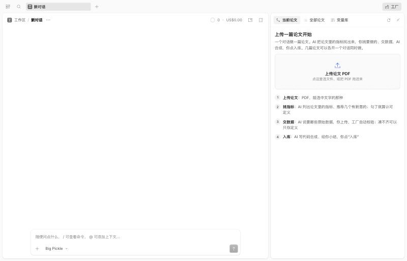
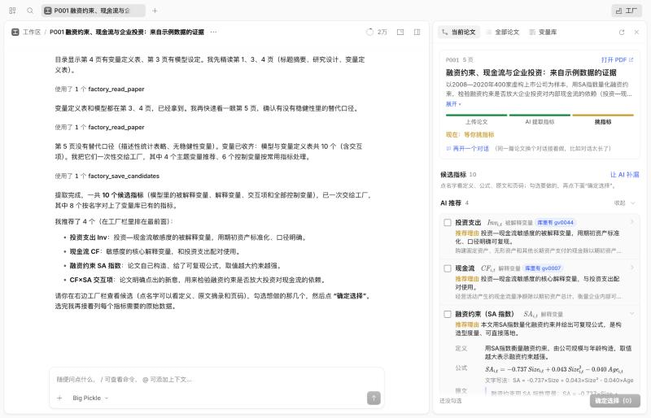
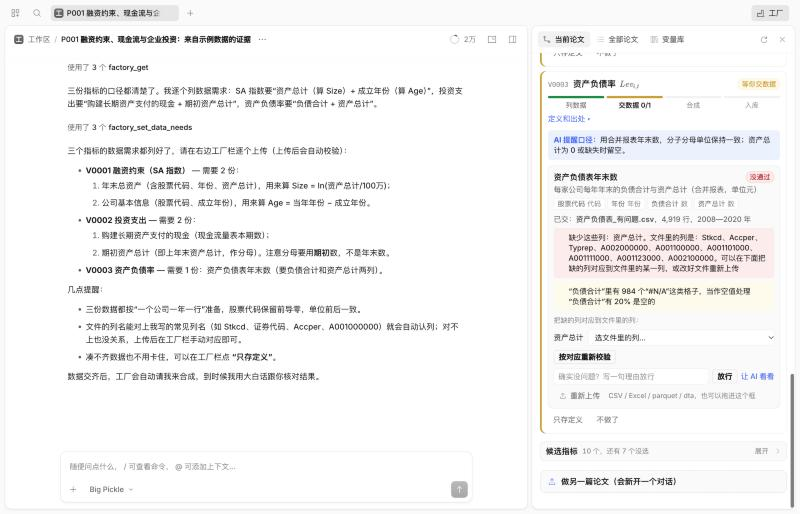
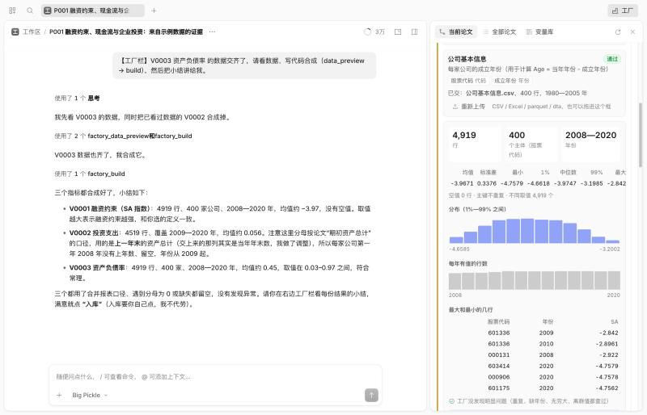
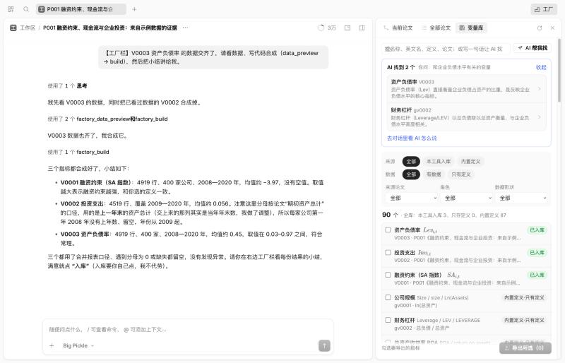
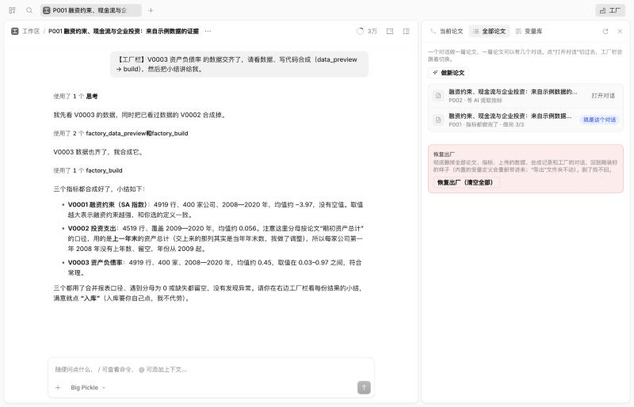

# 变量库工厂（单人版）

**从一篇论文出发，把论文里的指标做成可追溯的变量。** 在你自己的电脑上运行（**macOS 和 Windows 都行**）：左边是和 AI 的对话（[OpenCode](https://opencode.ai)），右边是“工厂栏”。

上传一篇实证论文 PDF → AI 把里面的指标找出来、推荐几个有新意的 → 你勾选要做的 → AI 说清要哪些原始数据 → 你上传数据、工厂自动校验 → AI 写代码合成、给你小结 → 你点“入库”。
每个变量都记着：出自哪篇论文第几页、原文怎么写、用了哪份数据（校验码）、你放行的理由、合成代码。



- 论文、数据、结果都只在你的电脑上（Mac：`~/变量库工厂单人版/`；Windows：`C:\Users\你的用户名\变量库工厂单人版\`）。只有 AI 模型会读到论文文字和数据片段。
- AI 只能“干活”，不能替你做决定：选指标、放行、入库都只能你在工厂栏里点。
- 自带 87 个常用变量的定义（名称、定义、公式），AI 判断“库里已有”时做参照。

---

## 最省事：让 AI 帮你装

打开 **[docs/让AI帮你安装.md](docs/让AI帮你安装.md)**，按你的系统（Windows / Mac）复制那一整段提示词，发给你的 AI 编程助手
（Claude Code、Codex、Cursor 等能在电脑上运行命令的）。它会检查缺什么、装好、打开，过程中用大白话告诉你在做什么。

想自己装，看下面。

## 要准备什么

| 东西 | Mac | Windows |
|---|---|---|
| 系统 | macOS 13 或更新（Apple 芯片、Intel 都行） | Windows 10 或 11 |
| Python 3.12 或更新 | `brew install python@3.13`，或到 [python.org](https://www.python.org/downloads/macos/) 下载（系统自带的 3.9 不行） | `winget install --id Python.Python.3.13 -e`，或到 [python.org](https://www.python.org/downloads/windows/) 下载（安装时勾选 “Add python.exe to PATH”） |
| Git | 一般已有；没有就 `xcode-select --install` | `winget install --id Git.Git -e` |
| OpenCode 2.2 或更新（在 2.2.7 上测过） | `brew install opencode`（Homebrew 见 [brew.sh](https://brew.sh)） | 先装 Node.js：`winget install --id OpenJS.NodeJS.LTS -e`，**重开窗口**后 `npm install -g @opencode/cli` |
| 浏览器 | Chrome、Safari、Edge 都行 | Edge、Chrome 都行 |

其余两项两边一样：
- **AI 模型**：OpenCode 自带免费模型，**不填 key 也能先用**；想更稳更快，接上你自己的模型服务（key 你自己填，见下文）。
- **网络**：安装时要下载依赖；用的时候 AI 模型要联网。

> Windows 上用 `winget` 装完东西，要**关掉 PowerShell 窗口再重新打开**，新装的命令才找得到。

## 三步装好

**Mac**：打开“终端”，依次运行：

```bash
git clone https://github.com/ZhongBintao/variable-factory-lite.git ~/variable-factory-lite
cd ~/variable-factory-lite
./install.sh
```

**Windows**：打开 PowerShell（开始菜单搜 “PowerShell”），依次运行：

```powershell
git clone https://github.com/ZhongBintao/variable-factory-lite.git $HOME\variable-factory-lite
cd $HOME\variable-factory-lite
.\install.cmd
```

（也可以在资源管理器里双击仓库文件夹里的 `install.cmd`。不要直接运行 `.ps1`：Windows 默认不让运行 PowerShell 脚本，`.cmd` 会替你放行这一个。）

安装脚本会检查系统、Python、Git、OpenCode，建虚拟环境装好锁定版本的依赖，跑一遍自检，生成示例论文和练习数据，最后在桌面放一个“变量库工厂（单人版）”（Mac 是小程序，Windows 是快捷方式）。哪一步不满足，它会停下来说清怎么办。


## 怎么打开

双击桌面上的 **变量库工厂（单人版）**（或在仓库里运行 `./start.sh`；Windows 双击 `start.cmd`）。等十几秒，浏览器会打开：左边是和 AI 的对话，右边是工厂栏。
右上角“工厂”按钮可以收起、打开工厂栏。

**第一次打开**可能遇到：
- macOS 问“是否允许访问‘桌面’（或‘文稿’）文件夹”：点“允许”（只有把仓库放在这些文件夹里才会问）。
- Windows 防火墙问“是否允许 Python / OpenCode 访问网络”：点“取消”或只勾“专用网络”都行——工厂只在本机用，不需要别的电脑连进来。
- 浏览器里先出现一下 OpenCode 的登录页：工厂会自动帮你登录，等一两秒就跳回来。

## 五个核心功能怎么点

练习材料：安装时已经在 `~/变量库工厂单人版/示例数据/`（Windows：`C:\Users\你的用户名\变量库工厂单人版\示例数据\`）里放了一篇**虚构的示例论文**（`示例论文_融资约束与企业投资（虚构）.pdf`）和几份**随机生成的练习数据**（资产负债表、利润表等 CSV）。也可以直接用你自己的论文和数据。

### 1. 上传论文，挑指标
在工厂栏点“上传论文 PDF”（或把 PDF 拖进去）。AI 先看论文目录，只精读摘要、研究设计、变量定义表和附录，一两分钟后列出全部指标。
候选分成“AI 推荐 / 其他指标 / 常用指标 / 变量库已有”几组，点组名展开。点指标名看定义、**排好版的公式**、原文摘录和页码（“打开这一页”跳到 PDF 那页）。
勾选要做的，点“确定选择”——**勾了就算你认可了它的定义**。



### 2. 交数据（自动校验）
每个选中的指标有一张卡和一条小进度：列数据 → 交数据 → 合成 → 入库。AI 说清要哪几份原始数据、每份要哪些列；你在每份下面点“上传数据”（CSV、Excel、parquet、dta）。
- 没通过：红字说清哪里不对。可以把缺的列**对应到文件里的某一列**，或写一句理由“放行”（理由会记下来），或点“让 AI 看看”。
- 数据暂时凑不齐：点“只存定义”，以后点“继续交数据”接着做。



### 3. 合成、看小结、入库
数据交齐后 AI 自动写代码合成（在受限的环境里跑：不能联网、不能动别的文件），卡上出现**小结**：多少行、多少家、哪几年、分布、最大最小的几行、要注意的地方。满意就点“**入库**”，不满意点“让 AI 重做”。



### 4. 变量库：筛选、AI 帮我找、导出
“变量库”标签里是你入库的变量和 87 个内置定义。可以按来源、有没有数据、来源论文、角色、数据形状筛选；在搜索框写一句话（如“衡量融资约束的指标”）点“**AI 帮我找**”，AI 会在库里找并写明理由。
勾选后点“导出所选”：生成一个文件夹，里面有每个变量的 CSV、按主键合好的宽表、`指标说明.xlsx`（定义、公式、出处、页码、原文摘录、数据校验码、放行理由）和合成代码。



### 5. 几篇论文同时做、恢复出厂
- 一个对话做一篇论文。在已经有论文的对话里再上传一篇，工厂会**自动新开一个对话**；同一篇论文对话太长，可以点“再开一个对话”。工厂栏跟着当前对话走。
- “全部论文”标签列出所有论文；最下面的“**恢复出厂**”（点两下生效）会彻底删除全部论文、指标、数据和工厂的对话，回到刚装好的样子。



## 换成自己的 AI 模型（可选）

不填任何 key 时，OpenCode 用它自带的免费模型，能把流程走通，但可能慢、偶尔出错。想更稳更快：
1. 在终端（Windows 是 PowerShell）运行 `opencode auth login`，按提示选你的模型服务商，**自己**粘贴 key（key 只存在你电脑上的 OpenCode 里，本工具不读、不存）。
2. 在 OpenCode 对话框下面点模型名，换成刚接上的模型。

不要把 key 发给任何人，也不要贴进对话或提交进 Git。

## 怎么更新到新版

```bash
cd ~/variable-factory-lite
./update.sh
```

Windows：双击仓库文件夹里的 `update.cmd`（或在 PowerShell 里 `cd $HOME\variable-factory-lite` 后运行 `.\update.cmd`）。

它会拉取新版、重装依赖、跑自检、更新桌面入口。你的论文和数据在 `~/变量库工厂单人版/`，更新不会动它们。版本号见 [Releases / Tags](https://github.com/ZhongBintao/variable-factory-lite/tags)。

## 环境和权限

- 只在本机运行：工厂服务只听 `127.0.0.1:8797`，别的电脑连不上；接口要钥匙（每台电脑随机生成，存在 `~/变量库工厂单人版/设置/`，只你自己能读）。
- AI 在专门的工作区（`~/变量库工厂单人版/工作区/`）里干活，那里的 OpenCode 配置禁止 AI 跑终端命令、改文件、上网；AI 只能用工厂提供的工具。
- AI 写的合成代码在单独的进程里跑，限时 5 分钟：
  - Mac：用 macOS 自带的沙箱（`sandbox-exec`）：不能联网、不能运行别的程序、只能写自己的临时文件夹、读不到 `~/.ssh`、钥匙串等。
  - Windows：系统没有这种沙箱，改由 Python 的“审计钩子”拦住联网、运行别的程序、调系统底层接口、写临时文件夹以外的文件、读放口令和钥匙的文件夹。比 Mac 的沙箱弱一些：防的是 AI 写错代码，不是防有人存心攻击。
- 桌面入口是安装时在你电脑上生成的：Mac 是 AppleScript 小程序（仓库放在“桌面 / 文稿 / 下载”里时，macOS 会问“允许访问文件夹”，点允许）；Windows 是一个快捷方式，指向仓库里的 Python（`pythonw.exe -m lite launch`），打不开会弹窗说原因。
- 数据位置：`~/变量库工厂单人版/`（Windows：`C:\Users\你的用户名\变量库工厂单人版\`；论文 PDF、上传的数据、合成结果、导出）。想换地方：设环境变量 `LITE_HOME`。
- Windows 上不要把仓库放进 OneDrive 同步的文件夹：同步会锁住文件，安装、更新容易失败。

## 遇到问题

见 [docs/常见问题.md](docs/常见问题.md)（端口被占用、OpenCode 没装或版本不对、key 无效、PDF 读不出字、浏览器没打开……按“现象 → 原因 → 怎么办”写）。

## 卸载

删掉仓库文件夹、桌面上的入口；不要数据了就再删 `~/变量库工厂单人版/`。

## 许可证

见 [LICENSE](LICENSE)。内置的公式排版库 KaTeX 是 MIT 许可（`lite/web/katex/LICENSE.txt`）。
